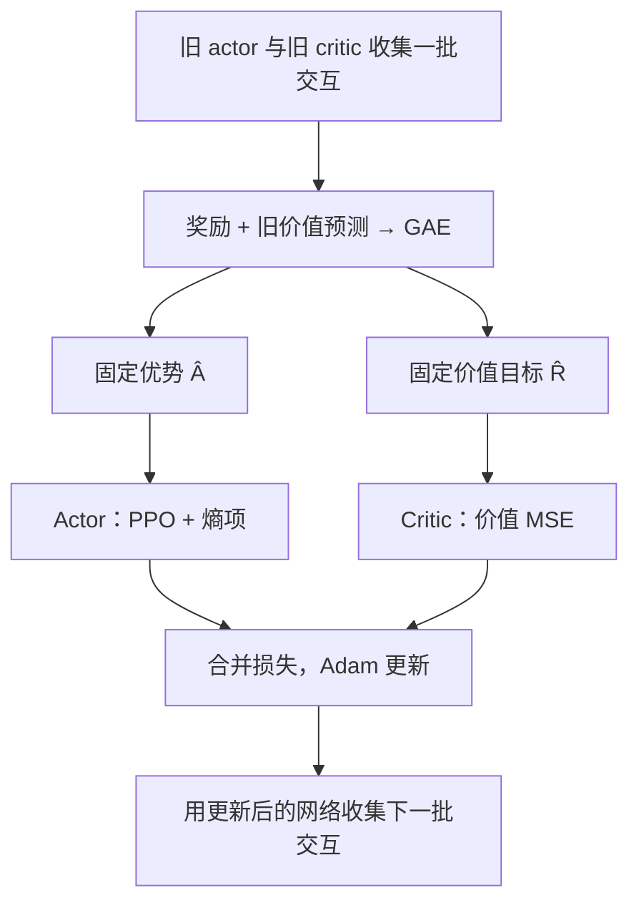

# 训练中的指标
| 指标 | 含义 | 这次运行的情况 |
|---|---|---|
| `TimestepsSoFar` | 累计训练环境步数，所有 pursuer 共同执行一次动作算一步 | 两行分别为 `8`、`16` |
| `EpisodesThisIter` | 本轮采样期间结束的训练回合数 | 都是 `0`，训练期间尚未捕捉成功或达到回合上限 |
| `EpLenMean` | 本轮结束的训练回合的平均长度 | `nan`，因为没有已结束的训练回合 |
| `EpRewMean` | 本轮结束的训练回合的平均累计奖励，每步先取所有 pursuer 的平均奖励，再累加 | 同样为 `nan` |
| `PolicyLoss` | actor 的 PPO clipped surrogate 损失，对本轮各 minibatch 的计算结果取平均 | 约 `-0.0000702`、`-0.0001452`，用于观察策略优化 |
| `ValueLoss` | 集中式 critic 预测值与 GAE 回报目标之间的均方误差 | 两批数据上分别约为 `16.11`、`12.12` |
| `Entropy` | 连续高斯动作分布的平均微分熵，反映动作采样的随机程度 | 都约为 `2.838`，训练步数少，变化很小 |
| `EvalMeanReturn` | 本次独立 eval 中，完整回合累计奖励的平均值 | 第 8 步约 `-229.83`，第 16 步约 `-235.51` |
| `EvalStdReturn` | 本次 eval 各回合累计奖励的标准差 | 都为 `0`，因为这次每次只评估了一个回合 |
| `BestEvalReturn` | 到目前为止，所有 eval 中最高的平均回报 | 始终为 `-229.83`，对应第 8 步模型 |
| `ElapsedSeconds` | 进入训练函数后的累计耗时，包含建图、采样、更新、eval 和模型保存 | 约 `5.22`、`9.38` 秒。训练后的 test 和动画耗时另记在测试的 `summary.json` 中 |


# 当前代码的训练架构(单步更新)


具体流程: 
1. 环境采样一次, 选出一个动作a(根据二维正态分布)
$$
a=\mu_\beta(s)+\sigma \cdot \epsilon, 其中 \epsilon ~ N(0, I)
$$

则
$$
a~N(\mu_\beta(s), \sigma)
$$

其中$\mu_\beta(s)$, $\sigma$是对应的$\pi_\theta(a|s)$中的可学习参数:
$\mu_\beta(s)$是一个以$\beta$为参数的网络, 输入s, 输出 $\mu_\beta(s)$; $\sigma$是一个可学习的参数.
由于输出的动作是二维的`(速度, 角速度)`向量, 这里的$\mu_\beta(s)$是二维向量, $\sigma$是二维协方差矩阵.
为了方便, 这里 $\sigma$ 是对角矩阵.
$\theta$实际是由$\beta$和$\sigma$两部分组成. 优化$\theta$, 实际是在优化$\beta$和$\sigma$.


为了满足一定条件, 会对a的两维度分别做阶段, 让数值在`[-1, 1]`之间, 然后进行放缩.
2. 同时还会记录其他数据: 每一步记录:
$$
(o_t,s_t,a_t,r_t,d_t,\log\pi_{\rm old}(a_t\mid o_t),V_{\rm old}(s_t))
$$
其中, Actor 输入是自身观测 \(o_t\)，集中式 Critic 输入才是全局状态 \(s_t\). 因此, 上面提到的 $\pi(a|s)$, 应该写作 $\pi(a|o_t)$.
3. Critic采用GAE估计, 使用奖励和更新前的价值预测计算：

$$
\delta_t=r_t+\gamma(1-d_t)V_{\rm old}(s_{t+1})-V_{\rm old}(s_t)
$$
(其中 $d_t$表示是否是终止步骤)
GAE 将这些 TD 误差按时间累积，得到优势估计 \(\widehat A_t\)。构造状态价值目标(GAE和TD($\lambda$)高度相似, 用相同的加权方法, 前者对TD error加权估计优势函数A=q-V, 后者估计状态价值V)：
\[
\widehat R_t=\widehat A_t+V_{\rm old}(s_t)
\]
Critic通过网络 $V_{\psi}(s_t)$, 以MSE为损失函数, 学习这个目标. 损失函数为: 
\[
L_{\rm value}(\psi)=\mathbb E_t\left[\bigl(V_\psi(s_t)-\widehat R_t\bigr)^2\right]
\]
4. 刚才算出来的 $\widehat A_t\$, 连通可以根据a, 计算 $\pi(a|o_t)$, 以及重要性采样比重 $\rho_t(\theta)$后续会一起拿给Actor网络.(这里有使用 mean-embedding)

\[\rho_t(\theta)=\exp\left[\log\pi_\theta(a_{{\rm raw},t}\mid o_t)-\log\pi_{\rm old}(a_{{\rm raw},t}\mid o_t)\right]
\]

> $pi_\theta(a|o_t)$会写成先取对数在套指数, 虽然和直接写没什么区别, 但log的形式也会出现在反向传播的表达式里面 $\nabla_\theta(\ln(pi_\theta(a|o_t)))$, 因此这样写方便一些, 而且有利于数值稳定性: $\pi_\theta(a|o_t) / \pi_{\rm old}(a|o_t)$, 如果都是很接近0, 不好算; 但如果按上述$\rho_t(\theta)$公式去计算, 会好一些
5. 直到收集了1024条这样的数据, 送给Actor和Critic网络, 通过反向传播更新参数.
6. 


# Lines of Code
1. `session.run`: tensorflow中的计算. 区分静态图 vs 动态计算. 这一步不涉及对环境的改变
2. `env.step()`: 真正把actions送进环境去交互, 算出来next_obs, rewards等


后续应该怎么做?

| 较大验证集上的表现 | 下一步 |
|---|---|
| 捕获率持续提高，提升明显超过评估不确定性 | 继续增加训练预算 |
| 捕获率接近，但全场景平均用时下降 | 仍有改进，可继续观察 |
| 新增约 30～50 万步后仍无明确改善 | 暂停加预算，检查探索、奖励和优化设置 |
| 表现持续退化 | 保留之前的候选模型，排查退化原因 |


针对你现有的模型，我建议：
1. 先比较已有的 500352 和 1000000 两个检查点。 用同一组新的 200 个验证场景，确认哪个更适合作为续训起点。
2. 下一阶段先追加 50 万步。 保留周期模型，观察较大验证集上的捕获率是否提高。
3. 将累计约 200 万步作为第一轮预算上限。 达到后重新判断，而不是预先认定必须训练到 1000 万步。
4. 最终从训练好的多个模型中, 根据200个场景进行验证, 从中选出1-2个最好的模型. 模型选定后：再用另一批独立场景做最终 test，报告结果。
```


1. "恢复 actor、集中式 critic 和 Adam 状态, 我理解的是actor和critic是通过保存的模型恢复的, 那Adam状态呢? 之前的训练过程也记下来了?&#x20;
2. 解释下那个progress.csv里面的Entropy值变大的含义吧, 不太懂这个和"截断"的关联?  以及你说的"`entropy_coef` 从 `0.01` 降到 `0.001`  "对应的是什么参数, 作用是什么?


**1. Adam 保存的是训练历史的“摘要状态”，不是完整训练过程。**

actor 和 critic 保存网络参数；Adam 还会为每个参与优化的参数维护两组数值：

| 状态 | 通俗理解 | 用途 |
|---|---|---|
| 一阶矩 `m` | 最近梯度方向的加权平均 | 让更新带有惯性 |
| 二阶矩 `v` | 最近梯度平方的加权平均 | 根据梯度大小调整各参数的更新幅度 |

它们每次更新都会吸收新梯度，因此包含了过去训练的影响，但无法还原每一步经历。[Adam 官方说明](https://www.tensorflow.org/api_docs/python/tf/compat/v1/train/AdamOptimizer)

你当前的代码在创建 Adam 更新操作后，才创建 `tf.train.Saver()`。所以保存检查点时，**网络参数和 Adam 状态一起存进了检查点文件**。

我刚核对了你的 40 万步检查点：里面有 **41 个变量，其中 22 个是 Adam 的状态变量**，例如：

```text
central_critic/dense/kernel/Adam
central_critic/dense/kernel/Adam_1
```

还包含用于偏差修正的 `beta1_power`、`beta2_power`。

因此续训时：

- 网络从原来的权重继续。
- Adam 从原来的梯度统计继续。
- 不需要读取 `progress.csv` 来恢复优化器。
- 历史观测、动作、奖励序列和环境中途状态没有被保存。

如果只加载网络、重新创建一个空的 Adam，仍然可以训练，但刚开始的更新轨迹会与恢复 Adam 状态时不同。

**2. Entropy 变大，表示训练时采样动作的分布变得更分散。**

你的 actor 在训练时使用高斯分布产生动作，可以写成：

\[
a=\mu(s)+\sigma\epsilon,\qquad \epsilon\sim N(0,1)
\]

其中：

- \(\mu(s)\)：网络根据当前观测给出的动作均值。
- \(\sigma\)：探索噪声的标准差。
- 实际动作 \(a\)：围绕均值随机采样得到。

例如均值都是 `0.3`：标准差小，动作通常靠近 `0.3`；标准差大，动作就更容易偏离它。

你日志中的 Entropy 是**两个动作维度的高斯分布微分熵之和**，计算公式是：

\[
H=\sum_{i=1}^{2}\log\sigma_i+\frac{2}{2}\log(2\pi e)
\]

所以在当前实现里，Entropy 上升意味着两个标准差的乘积变大，整体探索范围扩大。它不表示策略正确率，也不表示模型更有信心。[对应计算代码](C:/Users/lizhi/Desktop/deep_rl_for_swarms/deep_rl_for_swarms/common/distributions.py:195)

还有一个容易误解的地方：配置中的 `gaussian_fixed_var=True`，在这份实现里表示标准差不随观测变化，**标准差本身仍是可训练参数**。

它与“截断”的关联，发生在环境执行动作的时候。你的环境会做：

```python
执行动作 = np.clip(采样动作, -1, 1)
```

例如：

| 高斯分布采样值 | 环境实际执行值 |
|---:|---:|
| 0.4 | 0.4 |
| 1.3 | 1.0 |
| 2.8 | 1.0 |
| -1.7 | -1.0 |

这里更准确的说法是**动作裁剪或饱和**。多个不同的越界采样值，最终都会变成边界动作。

因此，这条关联是：

**Entropy 增大 → 探索分布更宽 → 在均值不变时更容易越界 → 更多动作被压到 `-1` 或 `1`。**

你的 40 万步模型中，两个标准差约为 `1.46`、`2.13`。即使均值为零，它们的越界概率也分别约为 **49%、64%**。这说明日志里看到的“探索更丰富”，未必能全部转化为环境里更有效的动作差异。

注意，这与 PPO 中 `clip=0.2` 的概率比裁剪是两种不同操作。

**`entropy_coef` 是“鼓励探索”的权重。**

你的训练损失在 [mappo.py](C:/Users/lizhi/Desktop/deep_rl_for_swarms/deep_rl_for_swarms/rl_algo/mappo.py:127) 中是：

```python
loss = policy_loss - entropy_coef * entropy + 0.5 * value_loss
```

训练会最小化这个损失。因为 Entropy 前面是负号，所以**增大 Entropy 可以降低损失**：这相当于额外奖励策略保持随机性，避免过早只选择一种动作。

将它从 `0.01` 降到 `0.001`，含义是：

> 把“为了保持随机性而获得的额外奖励”减小到原来的十分之一，让回报驱动的学习相对更有影响。

它**不会立即把动作噪声缩小到十分之一**。从检查点恢复后，标准差仍从 `1.46、2.13` 开始；降低系数只是减弱后续继续扩大分布的动力，Entropy 是否下降还取决于策略梯度等因素。

另外，你的评估和测试使用均值动作 \(\mu(s)\)，不采样探索噪声。前面这项诊断主要指向**训练阶段的探索方式**；是否影响最终捕获能力，需要通过对照实验验证。