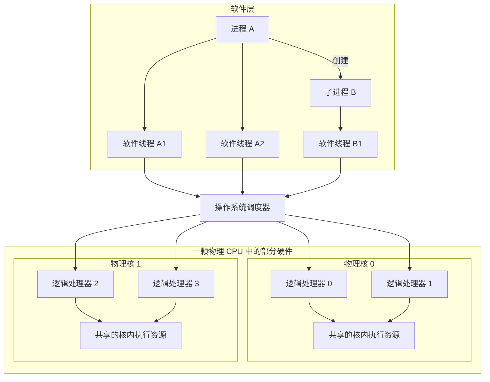
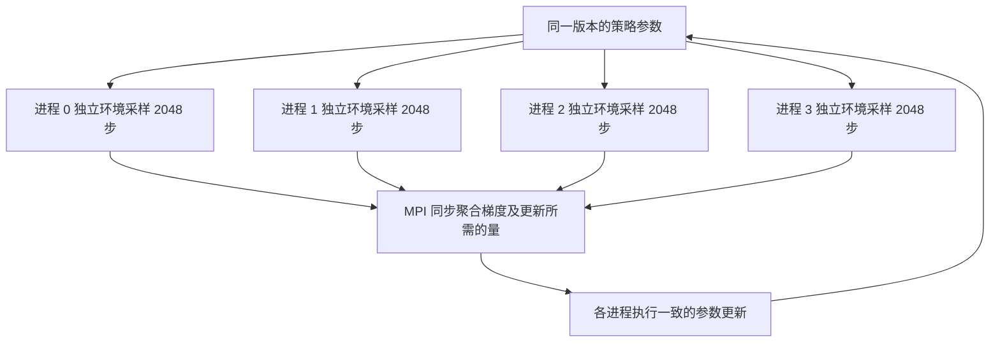

# CPU 调度、进程、线程与训练并行学习笔记

这份笔记从软件执行到 CPU 硬件，整理本项目训练涉及的并行概念。

## 1. 两套层级，由操作系统调度连接起来

**进程组织资源，软件线程负责执行。操作系统把可运行的软件线程安排到逻辑处理器上。**

| 概念                                   | 所在层面           | 含义                                                                                  |
| -------------------------------------- | ------------------ | ------------------------------------------------------------------------------------- |
| 物理 CPU                               | 硬件               | 一颗处理器，可以包含多个物理核。普通个人电脑通常安装一颗                              |
| 物理核 Core                            | 硬件               | 包含执行指令所需硬件的计算核心，核内有多个执行单元                                    |
| 硬件线程／逻辑处理器 Logical Processor | 硬件及操作系统视角 | 操作系统可以安排一条软件线程运行的位置。开启 SMT 时，一个物理核可以提供多个这样的位置 |
| 进程 Process                           | 软件               | 一个运行中的程序实例，管理内存空间、文件句柄等资源，至少包含一条线程                  |
| 软件线程 Thread                        | 软件               | 进程中的执行路线，有自己的执行位置、寄存器状态和栈，同进程的线程共享地址空间          |
| 子进程 Child Process                   | 软件               | 由另一个进程创建的进程。“父子”描述创建关系，每个子进程也有自己的线程                |



图中只画了两个核，逻辑处理器编号用于示意。线程可以在不同逻辑处理器之间迁移，也可以通过绑定限制运行位置。操作系统通常知道哪些逻辑处理器属于同一个物理核，调度时可以考虑这种共享关系。

一个进程有多条线程时，可以同时使用多个核。反过来，多条线程也可以轮流使用同一个逻辑处理器。进程数、线程数、逻辑处理器数和物理核数之间没有一一对应关系。

具体来说:
- 一个物理核可以承接不同逻辑处理器并行--只要他们的资源不冲突;
- 一个逻辑处理器在某一时刻只能执行一条软件线程. 多条线程轮流使用它时，操作系统快速切换，让任务交替推进。这叫**并发**
- 一个进程内部可以开几个不同的线程并行


## 2. “8 核 16 线程”里的线程是什么意思

以本次讨论的 Ryzen 7 8845HS 为例，8 核 16 线程表示 8 个物理核，每核支持 2 条硬件线程。SMT 开启时，操作系统通常看到 16 个逻辑处理器。

```text
一颗物理 CPU
├─ 物理核 0 → 两个逻辑处理器，共享这个核的计算资源
├─ 物理核 1 → 两个逻辑处理器，共享这个核的计算资源
├─ ……
└─ 物理核 7 → 两个逻辑处理器，共享这个核的计算资源

合计 8 个物理核、16 个逻辑处理器
```

程序可以创建几十个进程、几百条软件线程，数量受内存和系统资源限制。可运行线程多于逻辑处理器时，操作系统让它们轮流获得执行机会。等待输入或网络的线程通常会暂停等待，把 CPU 时间让给其他线程。

**增加进程或软件线程数量，增加的是待执行的工作。硬件提供的计算能力仍然由现有 CPU、核和其他资源决定。**

## 3. 并发、并行，以及 SMT

**并发 Concurrency** 表示多个任务在同一段时间内都在推进，可以通过交替执行实现。**并行 Parallelism** 表示多个任务在同一时刻实际执行。一个程序可以同时具有这两种特征。

设 A、B 各代表一条软件线程。

| A、B 被安排的位置            | 执行情况                                               |
| ---------------------------- | ------------------------------------------------------ |
| 同一个逻辑处理器             | 由操作系统切换，交替执行                               |
| 同一个物理核的两个逻辑处理器 | 通过 SMT，可以同时执行来自两条线程的指令，共享核内资源 |
| 两个不同物理核               | 可以同时执行，各自使用所在核的执行资源                 |

### 同一个逻辑处理器上的交替执行

```text
时间向右推进 →

逻辑处理器 0    [ A 运行 ][ B 运行 ][ A 运行 ][ B 运行 ]
```

逻辑处理器 0 在某一时刻运行一条软件线程的执行上下文。CPU 可能同时执行 A 内部的多条指令，但运行 A 的这段时间里，B 要等下一次被调度。

### 同一个物理核上的 SMT 并行

```text
线程 A → 逻辑处理器 0 ┐
                      ├→ 物理核 0 内的执行单元、缓存等资源
线程 B → 逻辑处理器 1 ┘
```

SMT 是 Simultaneous Multithreading，即同时多线程。物理核保留多条硬件线程的执行状态，并从这些线程的指令流中选择可以执行的指令。

例如，在资源和指令依赖允许时，A 使用某个整数运算单元，B 使用某个浮点运算单元，两边可以同时推进。两边需要同一个忙碌资源时，部分指令就要等待。执行资源由两条线程动态共享，具体能否同时执行取决于 CPU 设计和当前指令。

这里有两个不同的调度层面。

- 操作系统决定哪个软件线程在某个逻辑处理器上运行。
- CPU 核内硬件决定当前各条指令如何使用执行资源，时间尺度可以细到时钟周期。

**逻辑处理器 0 和 1 可以持续承载 A、B，硬件在它们之间分配核内资源。要推进 A，无需先由操作系统暂停 B。**

每核两条硬件线程有助于利用空闲资源，性能收益随任务变化。两条硬件线程共享一个核，因此 8 核 16 线程的性能不能按 16 个完整物理核计算。

## 4. 上下文切换与跨核迁移

**上下文切换 Context Switch** 是暂停一条线程，保存执行状态，再恢复另一条线程。例如，同一个逻辑处理器从执行 A 切换到执行 B。操作系统不会每次都把整个进程内存重新加载一遍。

**跨核迁移 Migration** 是同一条线程之后被安排到另一个物理核。除了调度开销，它还可能遇到缓存变冷的问题，之前常用的数据未必在新核的缓存里。

当很多线程持续争用 CPU 时，切换、缓存和带宽竞争可能降低效率。线程经常等待磁盘或网络时，让其他工作填补等待时间又可能提高效率。实际效果要看整项任务的完成速度。

## 5. 为什么要同时有软件调度和 SMT

软件线程调度能够处理磁盘、网络等待，也能通过轮流执行保证多个程序获得 CPU 时间。CPU 内部还会出现短得多的等待，例如缓存未命中、指令依赖和执行单元暂时不可用。

SMT 让硬件直接利用另一条指令流填补部分空闲，无需每次都进入操作系统调度流程。

继续细分任务也有边界。

- 软件可以创建更多线程、协程或任务，但它们最终仍要由有限的硬件执行。
- 硬件可以设计成每核支持更多硬件线程，但保存执行状态和选择指令也需要硬件成本。
- 当执行单元、缓存或内存带宽已经饱和，增加任务数量会带来更多竞争。

**提高利用率需要填补原有空闲。增加实际算力则需要增加或增强计算硬件。**

## 6. 为什么区分一颗 8 核 CPU 和八颗单核 CPU

两种配置都提供 8 个物理核，但核之间的连接方式、缓存组织和内存访问路径可能很不同。同一颗 CPU 的核通常通过片内互连通信，某些层级的缓存可以共享。跨物理 CPU 通信通常经过处理器间互连，多路系统还可能存在访问不同内存区域的延迟差异。

如果工作可以分成 8 份独立计算，两种配置都具备并行执行的条件。需要频繁交换数据时，硬件连接方式会明显影响性能。具体快多少还取决于处理器型号、内存和工作负载。

## 7. 选进程还是线程，先看共享内容和耗时位置

**线程天然共享同一进程的内存。进程通常拥有独立地址空间，可以通过队列、共享内存、MPI 等机制交换数据。**

| 要考虑的问题                               | 对设计的影响                               |
| ------------------------------------------ | ------------------------------------------ |
| 是否需要频繁访问同一份大数据               | 线程共享方便，进程也可以显式使用共享内存   |
| 是否会同时修改共享状态                     | 需要明确数据归属或同步机制，避免互相覆盖   |
| 耗时主要在 Python 循环、底层库还是等待 I/O | 决定线程或进程能获得多少并行收益           |
| 是否希望隔离环境、故障和运行状态           | 独立进程通常更容易隔离                     |
| 工作本身是否足够重                         | 太细碎的工作可能被启动、调度和通信开销抵消 |

本项目使用的传统 CPython 运行方式有 GIL，即全局解释器锁。同一进程中，同一时刻通常只有一条线程执行 Python 字节码。多个进程各有自己的解释器和 GIL，因此多个进程中的 Python 循环可以在多个核上同时执行。

NumPy、TensorFlow、PyTorch 等库的部分底层计算会释放 GIL，也可能使用自己的线程池。即使 Python 只启动一个主要计算线程，底层库仍可能使用多个核。等待 I/O 时，多线程也能让工作重叠。

## 8. 本项目 TRPO 的 single core 和 multi core

README 中的两种启动方式如下，从 `deep_rl_for_swarms` 子目录执行。

```bash
python run_multiagent_trpo.py
mpirun -np 4 python run_multiagent_trpo.py
```

**`-np 4` 指 4 个 MPI worker 进程。** 每个进程创建自己的 Rendezvous 环境和模型副本。原脚本每个环境有 20 个智能体，因此可以理解为“同时开 4 局，每局 20 个智能体”。环境中的智能体数量和操作系统进程数量分别由环境配置和启动方式决定。

脚本还使用 `single_threaded_session()`，把每个 TensorFlow 会话的算子间和算子内并行线程配置设为 1。MPI、NumPy 等组件仍可能有其他线程。这里的配置也没有把某个进程永久绑定到一个物理核。



这是并行采样、同步更新。策略梯度、Fisher 向量积、线搜索损失和价值函数梯度等计算涉及跨进程聚合，各 worker 会在相应的同步点等待彼此。

| 配置                      | 每轮合计采样的环境步数 |
| ------------------------- | ---------------------- |
| 1 个 worker，每个 2048 步 | 2048                   |
| 4 个 worker，每个 2048 步 | 8192                   |

一个环境步会推进这一局所有智能体。上表按环境步计数。原实现的训练步数日志还有一个细节，`TimestepsSoFar` 累加各 worker 已完成回合的长度，未完成回合会在结束后计入。

增加 worker 同时影响采样吞吐和每轮数据量。比较速度时，可以看每秒环境步数，也要关注固定总采样预算下的奖励或成功率。同步训练还会受到最慢 worker 的影响。

对应实现见 [TRPO 启动脚本](deep_rl_for_swarms/run_multiagent_trpo.py)、[TRPO 训练循环](deep_rl_for_swarms/rl_algo/trpo_mpi/trpo_mpi.py) 和 [TensorFlow 会话配置](deep_rl_for_swarms/common/tf_util.py)。

## 9. 同步、异步和模型副本是独立的设计选择

**进程／线程决定 worker 如何执行和共享内存，同步／异步决定它们何时提交或应用更新。** 两个维度可以分别设计。

同步训练通常让一批 worker 基于同一版策略采样，汇总结果后一起更新。异步训练允许某个 worker 准备好后提交更新，其他 worker 可以继续工作，它们使用的参数可能已经落后。

原始 A3C 使用多个线程，共享全局参数，并为各 worker 保留本地参数快照。worker 复制参数、采样、计算梯度，再将更新应用到全局参数。实现异步训练也可以使用进程和进程间通信。

模型存储也有多种安排。例如，多个环境进程可以只负责采样，将轨迹交给一个学习进程更新模型，再接收新参数。原仓库 TRPO 则让各进程持有模型副本，并同步聚合更新所需的量。

算法背景见 [A3C 原论文](https://proceedings.mlr.press/v48/mniha16.html)。

## 10. “共享环境”具体共享什么

**共享环境规则和配置** 时，各 worker 可以分别创建一个环境实例，独立推进多局。**共享同一个运行中的环境实例** 时，调用一次 `step()` 就会修改大家共同面对的状态，需要明确动作由谁决定、状态由谁推进。

即使用锁把多个线程的 `step()` 调用排好，同一个环境实例仍然只有一条按顺序推进的轨迹。让多个模型读取这条轨迹训练是可以设计的，但如果各模型希望按自己的策略采样，就需要明确实际执行哪个策略的动作。

对于本项目的追逃或聚集任务，多个独立环境实例可以提供多条并行采样的轨迹。环境实例可以归属于进程，也可以归属于线程，选择要结合 Python 执行开销和环境实现。

## 11. DataLoader 的 worker 在做什么

Python 版 PyTorch `DataLoader` 的 `num_workers=4` 表示使用 4 个数据加载子进程，另有训练主进程。`num_workers=0` 时，数据加载由主进程完成。它通常按需准备和预取若干 batch，具体流程由数据集实现和配置决定。

```text
数据加载进程 1 ─┐
数据加载进程 2 ─┤
数据加载进程 3 ─┼→ 已准备的 batch 队列 → 训练主进程 → GPU 计算
数据加载进程 4 ─┘

GPU 计算当前 batch 时，CPU worker 可以读取、解码、增强后续 batch。
```

提速来自多个 worker 并行准备数据，以及数据准备与模型计算的重叠。假设准备一批数据耗时 20 ms，GPU 计算耗时 40 ms，并且两者可以充分重叠，稳定运行后的每批耗时就有机会从约 60 ms 接近 40 ms。

如果训练和加载都依赖 CPU，worker 会与训练争用算力。worker 之间还可能争用内存带宽、缓存和磁盘，进程通信及预取也有开销。数据已在内存且处理很轻时，增加 worker 可能降低吞吐。

使用多个进程能够并行执行 Python 预处理代码。以 I/O 等待或释放 GIL 的底层计算为主时，多线程也可能有效。JAX 项目的加载参数含义取决于实际选用的数据加载器。

进一步阅读见 [PyTorch DataLoader 文档](https://docs.pytorch.org/docs/stable/data.html)、[数据加载优化教程](https://docs.pytorch.org/tutorials/intermediate/intermediate_data_loading_tutorial.html) 和 [JAX 数据加载文档](https://docs.jax.dev/en/latest/501/data-loading.html)。

## 12. 厨房比喻对照

下面的比喻用于理解资源关系。CPU 的实际执行能力由内部多个执行单元共同提供。

| 计算机概念         | 厨房中的对应物                                   |
| ------------------ | ------------------------------------------------ |
| 一颗物理 CPU       | 一间厨房                                         |
| 一个物理核         | 一个配有多种工具的操作工位                       |
| 核内执行单元       | 工位上的切菜、加热等设备                         |
| 每核两个逻辑处理器 | 工位可以同时跟进的两份工序单，各自记住做到哪一步 |
| 一个进程           | 一个班组，管理自己的材料、工具和记录             |
| 软件线程           | 班组里一条有先后步骤的工作流程                   |
| 操作系统调度       | 安排哪条工作流程当前进入哪个执行位置             |
| 上下文切换         | 保存当前工序进度，换另一条流程接着做             |
| SMT                | 从两份工序单里挑出可做的工序，同时利用空闲设备   |
| 多个独立环境       | 同时做多锅菜，各自推进                           |
| 同步更新           | 各组完成这一轮试做后，汇总意见修改食谱           |
| 异步更新           | 某组完成试做即可提交修改，其他组继续工作         |
| DataLoader worker  | 提前为下一批烹饪洗菜、切菜、备料的班组           |

增加订单和拆分工序，能帮助填补等待时间。设备已经满负荷工作时，更多订单、更多班组和更多调度层级也会带来管理与资源竞争。
